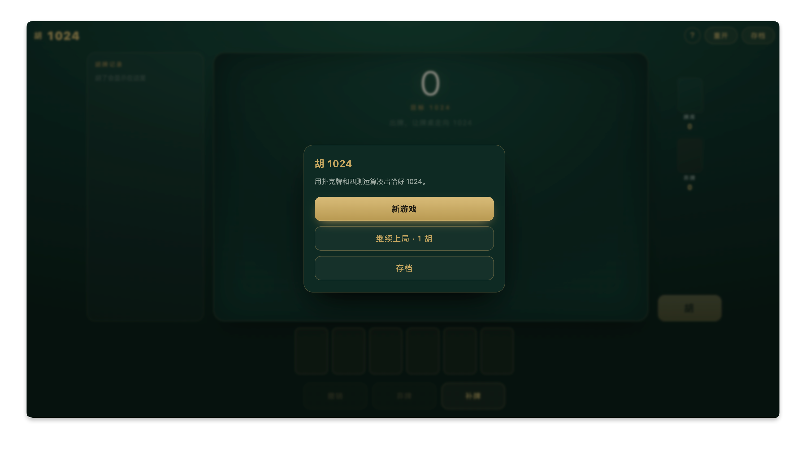
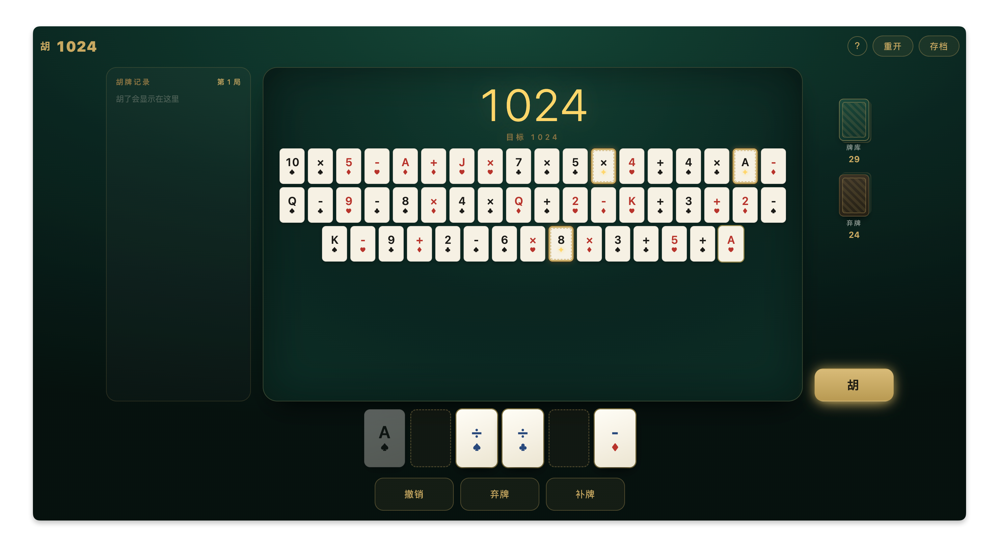
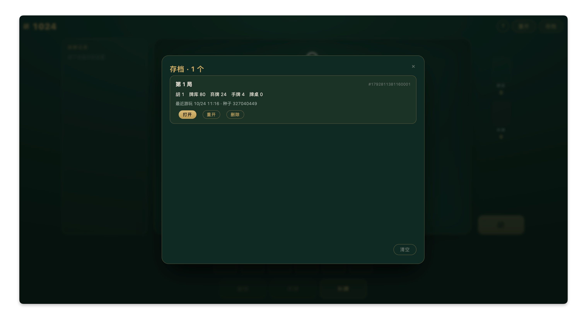

# 胡 1024

一整副扑克牌（108 张：数字牌 + 王 + 运算符牌），从手牌往牌桌上放，按**四则运算优先级**拼出恰好等于 1024 的算式——

```
牌桌：13 × 13 × 6 + 10  =  1024  →  胡！
```

胡牌后桌上的牌洗回牌库，胡数 +1，继续下一手。**分数 = 胡牌次数**，看你在牌库耗尽前能胡多少。

## 在线体验

**<https://hu-1024-card-game.app.workbuddy.host/?sharecode=LCYB3HECRH>**

免登录，浏览器打开即玩。

## 预览

| 开局 | 胡牌 | 存档 |
| -- | -- | -- |
|  |  |  |

## 玩法

1. 点「新游戏」，发 6 张手牌
2. 点手牌放到牌桌，保持数字、运算符交替（放 ÷ 时自动校验整除，除不尽直接拦下）
3. 桌上总值凑到 **1024**，点「胡」！
4. 凑不上？弃牌换血，或者重开再来

## 本地开发

```bash
npm install
npm run dev        # 开发服务器
npm run test       # Vitest 单测
npm run typecheck  # vue-tsc 类型检查
npm run build      # 类型检查 + 产物构建
```
